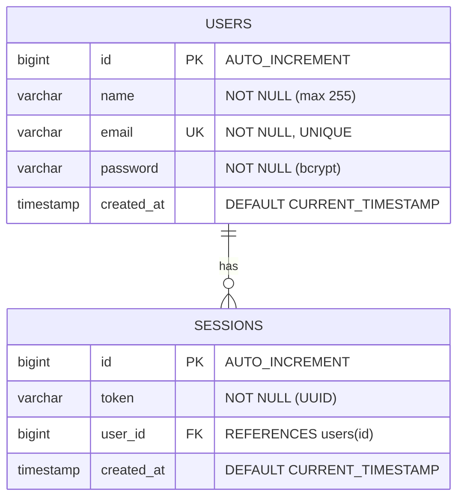

# User Authentication & Management RESTful API

[](https://bun.sh)
[](https://elysiajs.com)
[](https://orm.drizzle.team)
[](https://www.typescriptlang.org)
[](https://bun.sh/docs/cli/test)

---

## 📌 1. Deskripsi Proyek
Proyek ini adalah implementasi backend RESTful API untuk sistem autentikasi dan manajemen sesi pengguna dengan performa tinggi. Dibangun menggunakan arsitektur modular di atas **Bun runtime**, framework **ElysiaJS**, dan ORM **Drizzle** yang terhubung ke database **MySQL**.

### Fitur Utama:
- **Registrasi Pengguna**: Pendaftaran user baru dengan hashing password otomatis menggunakan algoritma **bcrypt**.
- **Autentikasi Login**: Verifikasi kredensial aman yang menghasilkan token sesi berbentuk **UUID v4**.
- **Proteksi Endpoint (Current User)**: Akses data profil pengguna aktif yang diamankan melalui header HTTP `Authorization: Bearer <token>` tanpa mengekspos hash kata sandi.
- **Manajemen Sesi & Logout**: Penghapusan token sesi aktif secara permanen dari database saat user logout, mencegah penggunaan ulang (*token reuse*).
- **Validasi Input Ketat**: Mencegah serangan *data truncation* dan payload tidak valid melalui schema validator Elysia (TypeBox).
- **Pengujian Otomatis**: Dilengkapi unit & integration test suite menyeluruh menggunakan `bun:test` dengan isolasi data independen.

---

## 🛠️ 2. Technology Stack & Libraries

| Kategori | Teknologi / Library | Fungsi & Deskripsi |
|---|---|---|
| **Runtime & Package Manager** | [Bun](https://bun.sh) | All-in-one JavaScript & TypeScript runtime super cepat dengan package manager native. |
| **Web Framework** | [ElysiaJS](https://elysiajs.com) | Framework backend modern dengan performa tinggi dan validasi skema TypeBox bawaan. |
| **Language** | [TypeScript](https://www.typescriptlang.org) | *Type-safety* penuh untuk menjamin keandalan kode dan meminimalkan runtime error. |
| **Database** | [MySQL](https://www.mysql.com) | Relational Database Management System (RDBMS). |
| **ORM & Migrations** | [Drizzle ORM](https://orm.drizzle.team) & [Drizzle Kit](https://orm.drizzle.team/kit-docs/overview) | ORM TypeScript-first berbasis SQL dialek MySQL dengan driver `mysql2`. |
| **Security & Hashing** | `Bun.password` (bcrypt) | Library kriptografi bawaan Bun untuk hashing dan verifikasi kata sandi secara asinkron. |
| **Session Generation** | `crypto.randomUUID()` | Generator UUID bawaan runtime untuk pembuatan token sesi unik. |
| **Testing Framework** | `bun:test` | Test runner bawaan Bun yang cepat untuk pengujian unit dan integrasi. |

---

## 🏛️ 3. Arsitektur & Struktur Folder

Aplikasi ini menerapkan pola arsitektur **Controller-Service-Data Layer** yang memisahkan tanggung jawab kode (*Separation of Concerns*) secara modular:

```text
├── drizzle/                      # File migrasi SQL hasil generate Drizzle Kit
│   ├── 0000_breezy_tomorrow_man.sql
│   ├── 0001_bouncy_cyclops.sql
│   └── 0002_certain_cammi.sql
├── src/
│   ├── db/
│   │   ├── index.ts              # Konfigurasi connection pool MySQL & instance Drizzle
│   │   └── schema.ts             # Definisi skema tabel users & sessions
│   ├── routes/
│   │   ├── health.ts             # Endpoint health check & status koneksi database
│   │   └── users-route.ts        # Controller routing ElysiaJS untuk /api/users
│   ├── services/
│   │   └── users-service.ts      # Logika bisnis (register, login, query DB, bcrypt)
│   └── index.ts                  # Entry point aplikasi server ElysiaJS
├── tests/
│   └── users.test.ts             # Test suite integrasi menyeluruh (bun:test)
├── .env.example                  # Template konfigurasi variabel lingkungan
├── drizzle.config.ts             # Konfigurasi Drizzle Kit untuk dialek MySQL
├── package.json                  # Konfigurasi dependensi dan script runner
└── tsconfig.json                 # Konfigurasi compiler TypeScript
```

### Konvensi Penamaan Berkas:
- **Routes (`src/routes/`)**: Menggunakan format kebab-case, contoh: `users-route.ts`. Bertanggung jawab atas pendefinisian HTTP method, parsing dan validasi header/body, pemetaan status code, dan pengembalian response JSON.
- **Services (`src/services/`)**: Menggunakan format kebab-case, contoh: `users-service.ts`. Bertanggung jawab atas eksekusi logika bisnis murni, query ke database via Drizzle ORM, enkripsi password, dan pelemparan error aplikasi.

---

## 🗄️ 4. Skema Database

Skema database terdiri dari dua tabel utama dengan relasi *One-to-Many* (1 user dapat memiliki banyak sesi aktif):



### 1. Tabel `users`
| Kolom | Tipe Data | Constraint | Keterangan |
|---|---|---|---|
| `id` | `SERIAL` (`BIGINT UNSIGNED`) | `PRIMARY KEY`, `AUTO_INCREMENT` | ID unik pengguna. |
| `name` | `VARCHAR(255)` | `NOT NULL` | Nama lengkap pengguna (maksimal 255 karakter). |
| `email` | `VARCHAR(255)` | `NOT NULL`, `UNIQUE` | Alamat email unik pengguna. |
| `password` | `VARCHAR(255)` | `NOT NULL` | Hash kata sandi pengguna (bcrypt). |
| `created_at` | `TIMESTAMP` | `NOT NULL`, `DEFAULT CURRENT_TIMESTAMP` | Waktu registrasi akun. |

### 2. Tabel `sessions`
| Kolom | Tipe Data | Constraint | Keterangan |
|---|---|---|---|
| `id` | `SERIAL` (`BIGINT UNSIGNED`) | `PRIMARY KEY`, `AUTO_INCREMENT` | ID unik sesi. |
| `token` | `VARCHAR(255)` | `NOT NULL` | Token sesi berbentuk UUID v4. |
| `user_id` | `BIGINT UNSIGNED` | `NOT NULL`, `FOREIGN KEY (users.id)` | ID user pemilik sesi. |
| `created_at` | `TIMESTAMP` | `NOT NULL`, `DEFAULT CURRENT_TIMESTAMP` | Waktu sesi login dibuat. |

---

## 📡 5. Dokumentasi Endpoint API

Base URL API: `http://localhost:3000`

### Ringkasan Endpoint

| Method | Endpoint | Kebutuhan Auth | Deskripsi |
|---|---|---|---|
| `GET` | `/` | Publik | Root endpoint (informasi status aplikasi). |
| `GET` | `/health` | Publik | Health check server dan status koneksi MySQL. |
| `POST` | `/api/users` | Publik | Registrasi akun pengguna baru. |
| `POST` | `/api/users/login` | Publik | Login pengguna & pembuatan token sesi. |
| `GET` | `/api/users/current` | **Bearer Token** | Mengambil profil pengguna yang sedang login. |
| `DELETE` | `/api/users/logout` | **Bearer Token** | Logout pengguna & menghapus token sesi. |

---

### Rincian Endpoint

#### 1. Registrasi Pengguna
- **Method**: `POST`
- **Path**: `/api/users`
- **Headers**: `Content-Type: application/json`
- **Request Body**:
  ```json
  {
    "name": "Dilan",
    "email": "dilan@example.com",
    "password": "rahasia123"
  }
  ```
- **Responses**:
  - **`200 OK` (Sukses)**:
    ```json
    {
      "data": "OK"
    }
    ```
  - **`400 Bad Request` (Email Sudah Terdaftar)**:
    ```json
    {
      "error": "Email sudah terdaftar"
    }
    ```
  - **`400 Bad Request` (Validasi Gagal - misal name > 255 karakter)**:
    ```json
    {
      "error": "Expected string length less or equal to 255"
    }
    ```

---

#### 2. Login Pengguna
- **Method**: `POST`
- **Path**: `/api/users/login`
- **Headers**: `Content-Type: application/json`
- **Request Body**:
  ```json
  {
    "email": "dilan@example.com",
    "password": "rahasia123"
  }
  ```
- **Responses**:
  - **`200 OK` (Sukses)**:
    ```json
    {
      "data": "550e8400-e29b-41d4-a716-446655440000"
    }
    ```
    *(Data mengembalikan string token sesi UUID v4)*
  - **`400 Bad Request` (Email / Password Salah)**:
    ```json
    {
      "error": "Email atau password salah"
    }
    ```

---

#### 3. Mengambil Profil Pengguna Saat Ini (Current User)
- **Method**: `GET`
- **Path**: `/api/users/current`
- **Headers**:
  ```http
  Authorization: Bearer <token_sesi>
  ```
  *(Catatan: Mendukung skema case-insensitive seperti `Bearer` maupun `bearer`)*
- **Responses**:
  - **`200 OK` (Sukses)**:
    ```json
    {
      "data": {
        "id": 1,
        "name": "Dilan",
        "email": "dilan@example.com",
        "created_at": "2026-10-23T13:35:34.000Z"
      }
    }
    ```
    > ⚠️ **Catatan Keamanan**: Field `password` tidak pernah disertakan dalam payload response.
  - **`401 Unauthorized` (Token Tidak Ada / Invalid / Sesi Kadaluarsa)**:
    ```json
    {
      "error": "unauthorized"
    }
    ```

---

#### 4. Logout Pengguna
- **Method**: `DELETE`
- **Path**: `/api/users/logout`
- **Headers**:
  ```http
  Authorization: Bearer <token_sesi>
  ```
- **Responses**:
  - **`200 OK` (Sukses)**:
    ```json
    {
      "data": "OK"
    }
    ```
    *(Token yang berhasil di-logout langsung dihapus dari database dan tidak dapat digunakan lagi)*
  - **`401 Unauthorized` (Token Tidak Valid / Sudah Pernah Logout)**:
    ```json
    {
      "error": "unauthorized"
    }
    ```

---

## 🚀 6. Panduan Instalasi & Menjalankan Aplikasi

### 1. Prasyarat Sistem
Pastikan sistem Anda telah memiliki:
- [Bun](https://bun.sh/) (versi 1.1.0 atau lebih baru)
- [MySQL Server](https://dev.mysql.com/downloads/) (versi 8.0 atau MariaDB) yang berjalan di port `3306`

### 2. Kloning Repository & Instalasi Dependencies
```bash
git clone https://github.com/DilanAhoy/belajar-vibe-coding-3.git
cd belajar-vibe-coding-3
bun install
```

### 3. Konfigurasi Environment (`.env`)
Salin file template `.env.example` menjadi `.env`:
```bash
cp .env.example .env
```
Sesuaikan nilai konfigurasi dengan kredensial database lokal Anda:
```env
# Server Configuration
PORT=3000

# Database Configuration (MySQL)
DB_HOST=127.0.0.1
DB_PORT=3306
DB_USER=root
DB_PASSWORD=
DB_NAME=belajar_vibe_coding
```

> **Pastikan database sudah dibuat di MySQL**:
> ```sql
> CREATE DATABASE IF NOT EXISTS belajar_vibe_coding;
> ```

### 4. Eksekusi Migrasi Database
Gunakan Drizzle Kit untuk men-generate dan mengaplikasikan skema ke MySQL:
```bash
# Generate file migrasi baru (jika mengubah skema)
bun run db:generate

# Menjalankan Drizzle Studio (Database GUI Web di browser)
bun run db:studio
```

### 5. Menjalankan Server
- **Mode Development (Watch Mode)**:
  ```bash
  bun run dev
  ```
- **Mode Production**:
  ```bash
  bun run start
  ```
Server akan aktif di `http://localhost:3000`.

---

## 🧪 7. Menjalankan Pengujian

Proyek ini telah dilengkapi dengan suite pengujian otomatis (`bun:test`) sebanyak **19 skenario pengujian komprehensif** (mencakup happy path, validasi input, pencegahan duplikasi data, bcrypt verification, dan session isolation).

### Menjalankan Unit & Integration Test
```bash
bun test
```
*Catatan: Sistem pengujian secara otomatis membersihkan database sebelum dan sesudah setiap skenario tes (`beforeEach`/`afterEach`) agar hasil tes konsisten dan independen.*

### Memeriksa Kesesuaian Tipe Data (Typecheck)
```bash
bun run typecheck
```

---

## 📜 Lisensi
Proyek ini didistribusikan untuk keperluan pembelajaran pemrograman web modern (*Educational & Open Source Purposes*).
